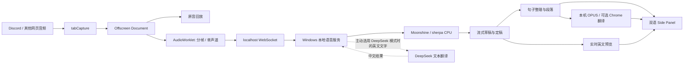

# NimDaydu 本地开发方案

> 调研日期：2026-10-07（Asia/Singapore）。
> 状态（2026-10-14 更新）：扩展 v0.5.1 修复自动保存更新引入的采音页启动失败，兼容本机服务 0.5.0。默认自动保存至项目 OUTPUTS，可关闭；支持 Chrome 翻译恢复与 Small 实时英文 + Parakeet 原音复核。真实 Chrome 60 分钟与 Discord/Slack 长会议验收尚未完成。
> 适用范围：个人自用，Chrome 中的 Discord、YouTube、Slack 等普通音频网页，英文语音转录并翻译成简体中文。

## 1. 推荐结论

**第一版采用 Chrome Manifest V3 插件 + Windows 本地语音服务。**

推荐组合：

- 音频采集：`chrome.tabCapture` + Offscreen Document + AudioWorklet。
- 本地转录：v0.4 增加 **Moonshine English Small Streaming + Parakeet TDT 0.6B v3 INT8 原音复核**，都在 CPU 上运行；Small/Medium 单模型仍可选择。英文草稿与最终复核分开，不使用文字 LLM 猜回音频。
- 翻译：首版默认 **本机 Argos/OPUS 英中模型 + CTranslate2**；Chrome Translator 可选；已有 DeepSeek 作为用户主动选择的文本翻译模式。
- 界面：先做 Chrome Side Panel 中的双语字幕，再做置顶浮动字幕。
- 本地服务：Python + FastAPI，通过 `127.0.0.1` WebSocket 与插件通信。
- 安装：开发者模式加载本地插件；本地服务提供启动脚本，后续打包成一键启动工具。

在本地转录和本地翻译都通过验证后，日常使用没有语音或翻译 API 用量费。首次安装及模型下载需要联网；选用 DeepSeek 翻译时，会产生已有 API 的用量费用，并发送字幕文字。

**不新增付费转录服务，不把音频上传到 Lightsail，不设置付费 ASR 自动回退。** Lightsail 暂时不参与主链路。用户的电脑比现有小型服务器更适合做本地推理。

完全零延迟不能作为承诺：识别需要积累音频，英译中需要足够上下文。根据用户最新决定，英文草稿立即显示并允许修订；中文等待句子整理、翻译完成后一次显示，允许少量额外等待。两条显示链路分开，英文不再等待分句与翻译。已经取得的本机实测数据见 [docs/benchmarks.md](docs/benchmarks.md)。

### 1.1 首版实施记录

2026-10-07 已完成 `extension/`、`local-service/`、模型下载、启动/停止脚本及 [README.md](README.md)。Chrome 中的真实标签页声音已通过 tabCapture → AudioWorklet → 本机 ASR → 本机翻译 → 双语侧栏链路。未新增付费服务，也未调用真实 DeepSeek API。

默认线程池导致 Small/Medium 原始实测不能稳定实时；使用上游提供的 `MOONSHINE_ORT_SINGLE_THREAD=1` 后，Small 的推理时间/音频时长比从约 1.02 降到 0.37。默认选择 Small，首个非空草稿约 0.66 秒，合成短句句尾后的定稿延迟约 0.25–0.72 秒。这些数据不代表真实多人会议的准确率或延迟保证。

Chrome Translator 在独立测试 Chrome 中暴露 API，但英中组件仍为 0.0.0.0，创建语言包超时。因此第一版增加无需新账号、无需密钥的本机离线翻译，短句推理约 0.05–0.10 秒。Chrome 模式保留，可在日常 Chrome 中另行验证。[Argos 官方英中包索引](https://github.com/argosopentech/argospm-index/blob/main/index.json)、[Argos 推理实现](https://github.com/argosopentech/argos-translate/blob/master/argostranslate/translate.py)。

v0.3 已实现：固定标签页音源、平台网址识别、默认双语、实时英文预览、完整句子整理后一次翻译、暂停/恢复、搜索与 TXT/JSON 导出、独立设置页、自动连接鉴权、断开清理、关闭视图自动停止，以及翻译输入的手工英文术语标准化。原声不上传；默认不使用 DeepSeek。当前尚未实现：应用内历史阅读器、中文术语字典、悬浮字幕、桌面音源、说话人识别、Arc/NPU 加速。

本次用户明确决定：主页面简洁、无营销文字；高级配置全部移到独立设置页；默认中英同时显示，英文不折叠；英文尽量实时，中文以完整、稳定的阅读结果优先，允许智能分句带来的少量延迟；通用 Chrome 网页采音，不仅支持 Discord。当前以保守的停顿、连接词、日期和主题规则实现整理，不使用 LLM 补写原文。

自动连接使用固定 `manifest.key` 与确切的 `chrome-extension://kmjdcdmffbieodadiegbnfjopendpblp` Origin；不会向任意网页开放令牌接口。[Chrome manifest key 官方说明](https://developer.chrome.com/docs/extensions/reference/manifest/key)。

v0.3.1 修复：旧版将一次满队列直接判为 ASR 无法实时，遇到延迟后突发音频就断开。保持服务端 25 帧缓冲，满时采用有时限的回压等待和追赶；扩展发送缓冲同样允许有限恢复。真实 48 kHz 模型重放中，三秒发送延迟后的 295 帧全部处理，Chrome 本地翻译并行检查也通过。错误后的采集资源立即清理，已有字幕保留。详见 benchmarks；这不能替代真实长视频验收。

v0.4（2026-10-14）：Chrome 翻译单次执行超时 8 秒；临时错误后重建实例，句子有限重试，其他句子继续，失败项可手动补译。成功译文仅发布一次，投递重试复用结果；切换会话时取消旧请求。新增实际 React 视图回归，验证中文失败不会关停英文或使翻译永久失效。更多菜单可导出数值诊断，不包含音频、字幕、URL 或密钥。

识别升级使用独立复核线程，保留即时英文，完整原音复核后才提交不可变句子。先合并 Moonshine 强制分割的重叠区域，避免将重叠的半秒声音重复转录。复核任务最多两个，内存音频窗口 90 秒，单次范围上限 30 秒；失败、超载或结束等待超时时保留原识别结果并提示。支持经确切扩展 Origin 与令牌认证的空闲时模型切换，选择持久保存。模型和数据集的归属见 THIRD_PARTY_NOTICES。

用户提供的游戏音频定位到原生引擎将临时识别撤回为空、适配器却没有处理，导致后续定稿阻塞；另以回归重现续句时间变化后的过期版本号边界。现按最新预览版本提交定稿，并正确撤回临时内容、释放前句。同一游戏音轨前两分钟重放得到 36 条完整译句、1538 帧全部处理，中途不再阻塞到结束。不能把英文仍更新、中文停滞一律归因于 Chrome 翻译。

本轮以约 18 分钟、160 条、11 位说话人的 LibriSpeech test-clean/test-other 公开人声及参考文本比较模型，而非凭合成音频判断准确度。整段文件与实时切片的结果分别记录，不能把整段 Parakeet 分数当作实时插件分数。Chrome 实机检查被自动审批拦截，工具无法可靠判定当前浏览器 URL；已停止浏览器操作，不能宣称完成 Chrome 长时间测试。详细数据与限制见 benchmarks。

v0.5（同日）：用户要求默认开启自动保存，已在设置中加入开关，并按日期/平台/会话 ID 保存到 `E:\Projects\UniBuni\Nimdaydu\OUTPUTS`。本机服务持续记录定稿英文，扩展将已完成中文补入同一会话的 `session.json`、`transcript.txt`；I/O 独立于 ASR 执行器，通常约一秒检查点，正常结束补写。支持当前会话关闭/重新开启，不回填关闭期间的新句子，不删除旧文件。目录已加入 Git 忽略；不保存音频、实时草稿或密钥。强制关闭/断电仍可能丢失最后尚未写出的内容，历史阅读器仍未实现。

v0.5.1（同日）：用户实机点击开始出现 `Cannot read properties of undefined (reading 'state')`。根因是 v0.5 在 Offscreen Document 直接使用 `chrome.storage`，超出该页面仅支持 runtime 的扩展 API 范围，脚本在注册消息监听前失败；后台又未检查空回复。设置读取/监听现由 Service Worker 承担，通过消息传递自动保存选项。新增真实 API 范围的启动回归、有上限的就绪握手、空回复防护及并发启动保护，修复只涉及扩展。

## 2. 已确认需求与资源

| 项目 | 已确认内容 | 对方案的影响 |
|---|---|---|
| 产品名 | NimDaydu | 插件、界面和文档统一使用这个名字 |
| 使用对象 | 仅本人 | 不做账号系统、订阅、多人协作或商店发布 |
| 第一场景 | Chrome 中的 Discord 网页版 | 优先采集标签页声音，减少平台专用适配 |
| 内容类型（10 月 14 日确认） | 生活娱乐/游戏；母语者与非母语者混合的编程、AI 会议及小组讨论 | 分开验证游戏音效、口语、多人重叠、不同口音和技术专名；朗读基准不能替代这些场景 |
| 语言 | 主要英文 → 中文 | 第一版固定 `en → zh`，不依赖自动语言识别 |
| 用量 | 每月最多约 5 小时 | 不值得优先投入复杂服务器推理部署 |
| 费用偏好 | 不新增付费服务，优先本地转录 | 云端 ASR 仅保留为调研比较，不进入第一版 |
| 延迟偏好 | 英文尽量实时；中文接受完整句子整理的少量等待，不随草稿变化 | 英文预览立即显示，定稿后一次翻译并补入中文 |
| 自己的声音 | 可以不包含 | 首版不请求麦克风，不做双音轨混合和回声消除 |
| 已有 API | DeepSeek | 用于文字翻译，不视为已拥有语音转录接口 |
| 电脑 | Windows 11，Core Ultra 5 125H，32 GB RAM，Intel Arc 集显，Intel AI Boost NPU | 先用 CPU；Arc/NPU 属于后续优化选项 |
| 服务器 | 新加坡 Lightsail，2 核，约 3.7 GiB RAM，可用约 2.4 GiB，已有服务 | 暂不部署模型；低瞬时负载不能证明持续推理能力 |

尚需在开发前检查的环境信息：Chrome 实际版本、Python/Node 是否已安装、模型下载网络是否可用。DeepSeek 暂按官方 API 处理；如果实际使用的是代理服务，其模型名、参数和价格需要单独验证。无需把任何密钥写进本文件或聊天。

## 3. 产品范围与界面

### 3.1 第一版必须具备

1. 选择当前标签页作为音源，开始、暂停、恢复、停止。
2. Discord 网页版的通话声音与直播播放声音都能进入同一条转录链路。
3. 英文草稿实时显示；整理成句后进入正文，中文完成后再补入。
4. 中文与英文默认同时显示；原文/译文等显示偏好移到独立设置页。
5. 字体大小、字幕窗口宽度、自动滚动、回到实时。
6. 主页面显示音源和采集中/暂停/断开；模型与连接诊断放入设置。
7. 会话内搜索、复制，以及手动导出 TXT / JSON；SRT / VTT 在时间轴验证后加入。
8. 本地模式可在模型就绪后断网使用；DeepSeek 模式与本地模式明确区分。

### 3.2 参考图的设计取舍

采用中性深色界面，中文主行、英文次行、安静的时间标记与短段落。主页面只保留核心控制和内容，显示偏好放入独立设置页，搜索和导出放入“更多”。不使用营销标语，英文默认可见。

```text
NimDaydu                         [设置] [更多]
Discord  当前网页名称
● 正在聆听   00:12                  EN → 中文

00:12  我们先修改控制器，然后再提交。
       Let's update the controller first, then commit.

00:15  实时英文
       Please open the application
       正在整理译文…

[暂停]                                [结束]
```

参考图里的笔记、AI 问答和总结不是第一版前置功能。先把听懂和阅读做好，再考虑这些扩展。

### 3.3 暂不纳入第一版

- 自动识别 Discord 用户名、头像或每位说话者；混合音频没有可靠的身份映射。
- 语音播报译文、双向同声传译、自动回复会议。
- 麦克风采集、音频长期保存、云端历史同步。
- 自动读取页面、聊天、屏幕内容作为上下文。
- 手机、其他浏览器、跨设备使用、Chrome 商店上架。

“通用”优先指**能在目标 Chrome 标签页播放的音频**。桌面应用、受保护媒体、独占输出设备、多个同时发声的标签页需要分别验证，不能宣称覆盖所有会议和视频。

## 4. 关键可行性与限制

### 4.1 标签页音频采集

Chrome 官方支持在用户调用插件后，通过 `tabCapture` 获取标签页媒体流。Chrome 116 起，Service Worker 取得的 stream ID 可交给 Offscreen Document 消费。采集标签页后，需要将媒体流接回 `AudioContext.destination`，否则原页面声音可能停止播放。[采集指南](https://developer.chrome.com/docs/extensions/how-to/web-platform/screen-capture)、[tabCapture API](https://developer.chrome.com/docs/extensions/reference/api/tabCapture)。

实现要点：

- 以用户点击工具栏图标作为明确的采集入口，记住所选 `tabId`，不要在切换标签后悄悄更换音源。
- 先创建或确认 Offscreen Document，再获取并立即消费一次性 stream ID。
- 音频一路回放，另一路送去识别；回放不能形成再次采集自身输出的反馈环。
- 同一标签页的远端通话、直播声音、提示音可能混在一起。可用 VAD 和字幕过滤减少干扰，但不把提示音过滤描述成完美分离。
- 标签页播放音频通常不包括自己的麦克风输入。首版按已确认需求处理。

### 4.2 为什么音频不放在普通 popup 或 Service Worker

工具栏 popup 关闭后不能可靠承担持续采集。Service Worker 没有 DOM，且可能在空闲后终止。Offscreen Document 适合持有音频流；它仅支持 `chrome.runtime` 这一组扩展 API，其他扩展能力通过消息交给 Service Worker。[Offscreen API](https://developer.chrome.com/docs/extensions/reference/api/offscreen)、[Service Worker 生命周期](https://developer.chrome.com/docs/extensions/develop/concepts/service-workers/lifecycle)。

音频会话由 Offscreen Document 和本地服务持有，面板负责呈现。首版采用一个可见字幕视图的会话策略：关闭最后一个字幕视图后，短暂宽限并停止会话，释放音频与识别资源。切换标签页或向上滚动不停止会话。这样本地翻译可在可见文档中初始化，无须假设用户激活能从面板传递到隐藏文档。

### 4.3 浏览器端本地翻译

Chrome Translator API 提供按需下载的本地语言包，官方列出英文与中文；必须实际调用 `Translator.availability({sourceLanguage: 'en', targetLanguage: 'zh'})` 检查。初始化需要用户激活，且该 API 不适用于 Web Worker。[Translator API](https://developer.chrome.com/docs/ai/translator-api)。

第一版把翻译实例放在字幕视图的文档中，在“准备本地翻译”按钮内完成初始化。开发必须验证扩展 Side Panel 的实际可用性、下载过程、断网表现和中文效果。若不能使用，保留英文字幕，并提示选择已有 DeepSeek 翻译；没有主动选用云端模式时，不自动发送文字。

“Chrome 本地 Translator API”与“Chrome 内置 Live Translate”是不同能力：后者可能向 Google 发送字幕文字，不能把二者的离线或隐私性质混为一谈。

### 4.4 DeepSeek 的角色

本次查阅的 DeepSeek 官方公开接口以文字/视觉模型和 Chat Completions 等接口为主，未见可直接用于本项目的公开实时 ASR 入口。因此本方案用 DeepSeek 翻译**识别后的英文文本**，不向它发送音频。[官方接口](https://api-docs.deepseek.com/api/create-chat-completion/)。

当前官方模型名包含 `deepseek-flash`。字幕翻译应明确关闭 thinking，避免额外推理等待；不要直接套用过时的模型名或默认思考设置。[模型说明](https://api-docs.deepseek.com/quick_start/pricing/)、[Thinking Mode](https://api-docs.deepseek.com/guides/thinking_mode/)。

## 5. 本地转录引擎选择

### 5.1 推荐先测 Moonshine Streaming

Moonshine 官方提供本地流式转录、Windows/Python 支持，以及可接受外部音频块的 `Transcriber`。英语有 Medium、Small、Tiny Streaming 模型；英语这些模型为 MIT 许可。[项目](https://github.com/moonshine-ai/moonshine)、[模型列表](https://moonshine-voice.readthedocs.io/en/latest/models/available-models/)、[外部音频与转录事件](https://moonshine-voice.readthedocs.io/en/latest/api/classes/)。

本项目的选择顺序：

1. **Medium Streaming / CPU**：作为效果候选，预先加载，运行时不反复创建模型。
2. **Small Streaming / CPU**：与 Medium 对照；若准确率足够而延迟、风扇或会议流畅度更好，选它作为日常默认。
3. Tiny 只在资源占用仍不可接受时考虑，不以最小体积作为第一目标。

使用 `Transcriber.add_audio()` 输入标签页音频，订阅进行中与完成事件。不要使用默认打开麦克风的 `MicTranscriber` 代替标签页输入。

官方基准不能直接转化成本机 Discord 效果。会议口音、代码名称、多人抢话和压缩音频必须在真实场景中评估。

### 5.2 sherpa-onnx 作为备选

sherpa-onnx 支持 Windows、离线运行与流式识别。其英语 Zipformer 流式模型提供不同规模及 INT8 版本。[项目](https://github.com/k2-fsa/sherpa-onnx)、[英语 Zipformer 模型](https://k2-fsa.github.io/sherpa/onnx/pretrained_models/online-transducer/zipformer-transducer-models.html)。

先选一个英语 INT8 模型测 CPU。20M 小模型可作为轻量基线，但它基于 LibriSpeech，不能默认认为适合所有自然讨论。若小模型对口音或术语明显失误，再测较大的英语模型。模型包与运行库分别记录版本、校验值和许可。

### 5.3 Whisper 家族用于后续质量与多语言优化

| 路线 | 适合用途 | 本项目的处理 |
|---|---|---|
| faster-whisper CPU INT8 | 快速建立 Whisper 准确率对照 | 可测试 `base.en` / `small.en`；不直接把文件转录当作流式字幕 |
| whisper.cpp / OpenVINO | CPU 或 Intel 硬件推理 | 后续比较准确率、热量、延迟和安装复杂度 |
| OpenVINO GenAI Whisper | Intel Arc/NPU 加速候选 | CPU 首版完成后再实测，不把 NPU 作为安装前提 |
| WhisperLiveKit | 可复用的本地流式编排 | 当自己维护 Whisper 流式逻辑成本较高时评估 |

faster-whisper 的常用 GPU 路线需要 NVIDIA CUDA/cuDNN，不能因为电脑有 Intel Arc 就按 CUDA 教程安装。[faster-whisper](https://github.com/SYSTRAN/faster-whisper)。Whisper 的流式使用通常需要额外的缓冲与输出稳定策略；旧 WhisperStreaming 项目也已指出有更新的替代方案。[WhisperStreaming](https://github.com/ufal/whisper_streaming)、[WhisperLiveKit](https://github.com/QuentinFuxa/WhisperLiveKit)。

Intel 官方列出 Core Ultra、Arc 与 Windows 11 支持，并提供 Whisper NPU 推理路径；这证明可测试，不证明本机模型已经能稳定加速。[OpenVINO 系统要求](https://docs.openvino.ai/2026/about-openvino/release-notes-openvino/system-requirements.html)、[Whisper NPU 指南](https://docs.openvino.ai/2026/openvino-workflow-generative/inference-with-genai/inference-with-genai-on-npu.html)。sherpa 的 OpenVINO 路线还需要带该 Execution Provider 的运行库；普通安装并不会自动使用 Intel NPU。[sherpa OpenVINO 说明](https://github.com/k2-fsa/sherpa-onnx/blob/master/OPENVINO.md)。

### 5.4 是否可以只安装插件，不运行 Python

可以作为后续方向。Moonshine 提供 JS/WASM，sherpa 也支持 WebAssembly；浏览器内推理有机会把安装体验简化成一个插件。

首版选择本地服务，是为了先取得容易诊断的原生 CPU 性能，并保留 Arc/NPU 和桌面音频扩展空间。纯插件方案要额外验证 MV3 的 Wasm CSP、Worker 打包、多线程与模型缓存。ONNX Runtime Web 的多线程还依赖跨源隔离，不能默认继承原生推理性能。[Moonshine 快速入门](https://moonshine-voice.readthedocs.io/en/latest/quickstart/)、[Chrome Wasm CSP](https://developer.chrome.com/docs/extensions/reference/manifest/content-security-policy)、[ONNX Runtime Web 配置](https://onnxruntime.ai/docs/tutorials/web/env-flags-and-session-options.html)。

## 6. 延迟目标与字幕稳定策略

### 6.1 定义目标

英文以尽快显示识别结果为目标，允许当前草稿随更多声音修订；中文以完整、稳定字幕为目标，不显示实时译文草稿。实测和目标分开记录，不作为产品承诺。

| 指标 | 初始目标 | 计时口径 |
|---|---|---|
| 实时英文草稿 | v0.3 合成样本首个非空草稿约 0.57 秒 | 音频开始到服务发布，不等待整理与翻译；草稿可修订 |
| 译文整理等待 | 默认 0.8 秒；弱短语/日期通常 1.8 秒 | ASR 定稿后等待可续接片段，不影响英文预览 |
| 稳定中文 | v0.3 样本实测模型句尾后约 1.1–1.5 秒 | 整理完成与翻译返回；不含真实会议准确率保证 |
| 本地推理速度 | 流式实时重放时 RTF ≤ 0.5 为优先目标 | 推理计算时间 / 对应音频时长，且队列不持续增长 |
| 持续使用 | 60 分钟无崩溃、无明显积压 | 同时进行 Discord 通话和观看直播 |

模型先定稿，再结合连接词、日期续接和停顿整理；同一音频片段包含多句时再拆分。段落按停顿、主题变化和最多三句划分。暂停/停止会清理最后片段，未完整语句明确标记，不补造词语。关联的下一片段未定稿时可能继续等待，长句和复杂语义仍有局限。

### 6.2 处理方式

- 英文 partial 立即发布到独立预览区域；整理后的 final 与剩余预览同一次更新，避免重复显示。
- 定稿英文无需等待翻译；完整句子按顺序翻译一次，中文返回后补入对应段落。
- 已显示的译文不可覆盖，新句只追加；英文 partial 不触发翻译，也不进入最终字幕导出。
- 翻译队列有上限，服务端音频队列仍约两秒（25 个 80 ms 帧）；满时先回压等待，单次入槽等待最多三秒，一次追赶窗口最多八秒，持续过载再停止并提示。扩展发送缓存最多八秒 PCM，避免短暂突发被另一层两秒限制中断。
- `/health` 只保留最近会话的帧数、队列与处理耗时等本机数值，帮助区分瞬时突发和持续算力不足；不记录音频或字幕全文。
- 翻译响应必须匹配 `sessionId + segmentId + revision`；晚到的旧译文不能覆盖新字幕。
- 已确认的字幕保持稳定，纠错仅影响仍在处理的片段或显式修订，避免整个历史不断跳动。
- 本地引擎已有 VAD/断句时优先使用其能力。其他引擎需要时再接入 Silero VAD，测试前后缓冲和约 500 ms 尾部静音，不叠加两套冲突的断句逻辑。[Silero VAD](https://github.com/snakers4/silero-vad)。

所有翻译方式统一使用完整句子，不为本地模式增加实时中文预览。DeepSeek 只在用户主动选择时使用。

## 7. 推荐架构



### 7.1 技术栈

| 层 | 选择 | 理由 |
|---|---|---|
| 插件构建 | WXT + TypeScript | 管理 MV3、页面入口和打包；避免手工维护构建链 |
| UI | React + 简单 CSS | 复用 Side Panel 和后续浮动字幕组件 |
| 音频 | Web Audio + AudioWorklet | 持续处理音频，不在 UI 线程执行识别 |
| 本地 API | Python + FastAPI + Uvicorn | 直接接入本地 ASR 库，并提供 WS、状态和可选文本翻译 |
| 模型 | Moonshine Streaming，sherpa adapter 备选 | 免费本地推理，并支持真正流式输出 |
| 翻译 | 本机 OPUS / Chrome Translator / DeepSeek adapter | 本机默认 + 主动选择的其他方式 |
| 状态与历史 | 当前视图内存；默认本机 OUTPUTS 会话文件 | 定稿持续保存，翻译补写；IndexedDB 与应用内历史阅读器尚未实现 |
| 测试 | Python 测试 + 前端状态测试 + Chrome 实机验证 | 音频与浏览器生命周期不能只靠 mock |

WXT 的 Side Panel 与后台入口命名以官方 entrypoint 规则为准；Offscreen 使用其普通 HTML 页面入口打包。[WXT 入口文档](https://wxt.dev/guide/essentials/entrypoints.html)。Python 与 Node 的具体版本在建项目时根据依赖兼容性锁定，优先使用有预编译 Windows 包的组合。

### 7.2 各部分职责

**Service Worker**：响应工具栏操作、锁定音源、创建 Offscreen、路由控制消息、保存设置、恢复状态快照。不能把长期会话只存为全局变量。

**Offscreen**：持有标签页 MediaStream、AudioContext、AudioWorklet、本地 WS；负责原音回放、采集状态和停止清理。PCM 不经普通扩展消息逐帧转发。

**本地语音服务**：模型预加载、鉴权、分帧输入、单个 ASR 工作线程/执行队列、规范化字幕事件、可选 DeepSeek 翻译。同步模型推理与回调不能阻塞 FastAPI 的网络事件循环。

**Side Panel**：字幕显示、滚动、搜索、导出，以及本地 Translator。音频电平低频更新，字幕更新按事件合并，避免每个音频帧触发 UI 重渲染。

### 7.3 权限

首版预计使用 `tabCapture`、`offscreen`、`sidePanel`、`storage`、`activeTab`，以及访问 `http://127.0.0.1/*` 的 host permission。网络通信在扩展页面中进行，WS 服务另行校验 Origin；同时实测当前 Chrome 的 localhost 访问行为。[扩展跨源请求](https://developer.chrome.com/docs/extensions/develop/concepts/network-requests)。

不需要默认申请所有网站访问权，不需要 Discord token，也不需要注入 Discord 内部脚本。只有以后加入网页内字幕叠层时，才增加相应的 `scripting` 与按需页面访问能力。

### 7.4 音频格式与协议

先正确传音频，再优化字节数：

1. 使用真实 `AudioContext.sampleRate`，不把 48 kHz 音频误标为 16 kHz。
2. AudioWorklet 只做轻量处理与单声道合并；以约 80 ms 为初始发送批次。
3. 首版 localhost 传 `Float32 little-endian` 单声道音频；本地 adapter 转为模型需要的工作采样率。Moonshine 可在输入接口内处理采样率转换。
4. 若未来需要远程传输或优化，再增加连续重采样到 16 kHz、PCM16 的模式，保留滤波状态，避免分块边界丢样本。

WS 先发 JSON 握手：协议版本、会话 ID、音源类型、格式、采样率、声道和本地访问令牌。成功后发送带递增序号与 sample offset 的二进制音频帧。控制和字幕事件仍用 JSON。

不要把 `MediaRecorder.start(timeslice)` 产生的每个 WebM Blob 当作独立可解码录音。规范明确不保证单个分块独立可播放；本地流式链路选择 PCM，绕开这类容器问题。[MediaStream Recording 规范](https://w3c.github.io/mediacapture-record/)。

字幕事件至少包含：

```json
{
  "type": "caption",
  "sessionId": "session-id",
  "id": "sentence:1",
  "revision": 1,
  "start": 12.0,
  "end": 15.1,
  "text": "Let's update the controller first.",
  "final": true,
  "paragraph": 1,
  "incomplete": false
}
```

这是当前服务的整理后字幕结构示意，时间单位为秒，其他事件包括 `pending`、`state` 与 `error`。时间来自模型估计；拆分多句的时间按字符长度分配，不表示词级精确对齐，不伪造置信度。

### 7.5 会话与故障

状态机：`idle → preparing → capturing ↔ paused → stopping → stopped`；另有可恢复的 `reconnecting` 和需要操作的 `error`。

- 暂停时继续原声播放，但停止送去识别的音频，记录时间轴断点。
- 停止时 flush 最后字幕，关闭模型 stream、WS、track 和 AudioContext，并恢复正常标签页声音；模型权重可短期保留以便再次开始。
- 音频缓冲上限先设约 2 秒。服务跟不上时显示状态并记录缺口或暂停，不无限积压，也不假装字幕仍实时。
- 本地服务断开后有限次数重连；重连后创建新的识别 stream，保留已有字幕。断线音频没有保存时，不补造缺失字幕。
- 标签页关闭、设备切换、电脑睡眠、插件更新时明确结束或重新准备；不自动改采其他标签页或麦克风。
- 时间轴基于采集样本与会话计时；服务端时间与浏览器 `performance.now()` 不能未经对齐直接相减。

## 8. 翻译实现与术语

本地翻译默认使用 OPUS 英中模型，通过 CTranslate2 INT8 在 CPU 上推理；Chrome Translator 是可选适配器。一次只翻译整理好的完整句子，已有译文不因新句出现而重写。统一整理中文句末标点，保留小数与代码标识符。

DeepSeek：在独立设置页填写密钥，保存在本机忽略目录 `.nimdaydu/providers.json`；也支持 `.env`。调用非流式 Chat Completions，设置 `thinking: {type: 'disabled'}`，完整返回后一次显示。不会自动启用，不发送音频，不使用工具调用。[参数依据](https://api-docs.deepseek.com/api/create-chat-completion/)。

提示词表达的规则：忠实翻译为简体中文；保留代码、产品名、人名与数字；不解释、不总结、不回答原文问题；上下文仅供理解，只输出当前片段的译文。输入按字段区分 `context`、`glossary`、`currentText`，不把会话中的指令当作插件控制指令。

术语表由用户手工提供，例如 `controller → 控制器`，`commit → 提交`，项目名与类名保持英文。ASR 热词与翻译词表分别处理；不能通过 LLM 任意“润色”或补充没听清的英文。

先保留最近 1–2 个稳定片段作为 DeepSeek 上下文，限制长度。译文与原文分开存储，用户随时能检查识别错误到底发生在转录还是翻译。

## 9. 本地开发与安装体验

### 9.1 建议目录

```text
Nimdaydu/
  Plan.md
  README.md
  extension/
    wxt.config.ts
    entrypoints/
      background.ts
      offscreen.html
      offscreen.ts
      sidepanel/
      options/
      reader/                 # 后续浮动字幕的持久打开页面
    audio/
    captions/
    translation/
    components/
  local-service/
    pyproject.toml
    .env.example
    app/
      main.py
      sessions.py
      protocol.py
      asr/
        moonshine_adapter.py
        sherpa_adapter.py
      translation/
        deepseek_adapter.py
    tests/
  scripts/
    setup.ps1
    start.ps1
    stop.ps1
  models/                     # 模型缓存，不加入 Git
  samples/                    # 自己制作或允许使用的测试音频
  docs/
    benchmarks.md
    compatibility.md
```

目录包含已实现文件与后续规划，当前交付以 README 和实际源码为准。

### 9.2 初次安装流程

1. 安装符合项目要求的 Node 和 Python；所有 Python 依赖放入项目专用虚拟环境。
2. `setup.ps1` 检查环境，安装锁定依赖，下载选定英语模型，展示下载大小、进度与错误。
3. 启动本地服务，只监听 `127.0.0.1`；自检模型加载、接口和本地令牌。
4. 构建插件，在 `chrome://extensions` 打开开发者模式，选择“加载已解压的扩展程序”。[Chrome 安装教程](https://developer.chrome.com/docs/extensions/get-started/tutorial/hello-world)。
5. 本机语音与翻译模型由 setup.ps1 准备，扩展自动连接，无需填写配对码或选择模型。
6. 打开 Discord 网页版并播放声音，点击插件图标，确认音源后开始。

当前这台电脑已完成安装与构建；具体操作见 README。

### 9.3 日常使用

先运行 `start.ps1`，再在目标标签页打开插件。后续把语音服务打包为本地启动器，尽量隐藏控制台，并在 UI 显示启动失败原因。

首版不要求 Docker、WSL、Visual Studio、CUDA 或重装驱动。预编译库不兼容时先切备选引擎；只有明确需要编译或硬件加速时，才增加相应环境。

## 10. 数据与本地访问

- 默认不保存原始音频。短暂缓冲随会话释放。
- v0.5 默认在本机 OUTPUTS 保存定稿字幕，用户可在设置中关闭；旧文件手动删除，清空侧栏不删除已写文件。IndexedDB 和应用内历史阅读器尚未实现。
- `.env`、访问令牌、模型缓存、字幕导出和音频样本加入 `.gitignore`。
- API 密钥不打进插件 JS，不写进内容脚本，不同步到浏览器云端。
- 本地 HTTP/WS 校验随机令牌与允许的扩展 Origin；错误请求不能触发模型工作。仅监听回环地址。
- 日志默认只记状态、耗时、错误码，不记音频、字幕全文或密钥。
- UI 明确显示“本地翻译”或“DeepSeek 翻译”；云端模式只发送需要翻译的文本，不发送音频或屏幕。
- 会议与直播的使用按实际参与场景处理；如需告知转录，用户按该场景要求告知参与者。本方案不依赖会议机器人加入房间。

## 11. Lightsail 是否需要

**第一版不需要。** 已有服务器适合可选的文字翻译代理或未来远程入口，但把本机音频绕到新加坡服务器再识别，会增加网络路径与运维环节。

小型 Lightsail 存在 CPU 基线与突发容量机制；10 秒低占用采样不能代替 60 分钟模型负载验证。[Lightsail 性能说明](https://docs.aws.amazon.com/lightsail/latest/userguide/amazon-lightsail-faq-instances.html)、[CPU 基线](https://docs.aws.amazon.com/lightsail/latest/userguide/baseline-cpu-performance.html)。

如果以后明确需要远程文字代理，复用现有服务前先检查端口、域名、系统与资源；使用 HTTPS、独立访问令牌和有限请求量。现有服务无需为了 NimDaydu 提前迁移或停机。

## 12. 扩展到其他会议、视频与桌面客户端

| 音源 | 实现路径 | 支持等级 |
|---|---|---|
| Discord 网页通话/直播 | 捕获所在标签页播放的声音 | 第一版重点实测 |
| YouTube、网页课程、网页视频 | 复用标签页采集 | 第一版做兼容验证 |
| Meet、Teams/Zoom 网页版 | 复用标签页采集，不需要依赖网站 DOM | 逐站实测，不先宣称全部兼容 |
| 本地文件在 Chrome 播放 | 可能复用标签页采集 | 文件访问与声音行为单独验证 |
| Discord、Teams、Zoom 桌面版 | 系统音频采集 | 后续阶段 |
| 多音源/多个标签页 | 音源混合或多个 stream | 后续阶段，需解决身份、时间轴和资源问题 |

### 12.1 先做浏览器系统音频验证

在可见的扩展 recorder 页面调用 `getDisplayMedia({video: true, audio: true, systemAudio: 'include'})`，让用户在选择器中选择允许共享音频的来源。它要求视频请求，返回音频也不保证成功，必须检查 `getAudioTracks()`；选窗口不一定等于仅采该应用声音。[getDisplayMedia 文档](https://developer.mozilla.org/en-US/docs/Web/API/MediaDevices/getDisplayMedia)。

若可用，仅处理音频，不上传或保存画面。该 stream 由实际调用的 recorder 文档持有，不能用扩展 JSON 消息把 MediaStream 对象直接转交 Offscreen。关闭 recorder 或撤销共享应停止会话；测试结束视频 track 是否连带影响音频，不凭假设提前停止它。

### 12.2 再考虑本地 WASAPI helper

Windows WASAPI loopback 能捕获输出设备正在播放的声音。它默认是该输出设备的混合音频，可能包括系统提示音和其他应用；不会自然得到 Discord 用户名，也不等同于单进程采集。[Microsoft Loopback 文档](https://learn.microsoft.com/en-us/windows/win32/coreaudio/loopback-recording)。

本地服务可以增加系统音频 adapter，复用同一 ASR 与字幕协议。若需要更完整的桌面界面，再考虑 Electron 的 loopback 采集和置顶窗。[Electron desktopCapturer](https://www.electronjs.org/docs/latest/api/desktop-capturer)。首版不先引入桌面框架。

### 12.3 浮动字幕

优先验证 Document Picture-in-Picture：可以显示任意 HTML 的置顶窗口，但要用户操作触发，且窗口不能超过 opener 的生命周期。[Document PiP](https://developer.chrome.com/docs/web-platform/document-picture-in-picture)。

后续使用独立的扩展 reader 页面作为持久 opener，复用字幕组件。普通 `chrome.windows.create()` popup 不保证置顶。网页内 Shadow DOM 叠层是另一选择，但它只覆盖对应网页，且要处理全屏和页面导航。

## 13. 开发里程碑

投入估算只用于排序：M0–M4 约 6–10 个专注开发日，初次接触插件的人可能需要更久；打包、浮窗和硬件加速另计。以验收结果推进，不按日期跳过音频验证。

| 阶段 | 工作与交付 | 完成条件 |
|---|---|---|
| M0：验证最难环节 | 同一批英文音频比较 Moonshine Medium/Small；必要时加 sherpa；制作最小扩展检查 Translator；记录 `docs/benchmarks.md` | 明确一个可用本地 ASR，确认本地英译中或选择已有 DeepSeek；记录实际延迟、资源与错误 |
| M1：音频采集 | MV3 + Offscreen + AudioWorklet + localhost WS，只显示电平和状态 | Discord 直播声音可采、原声正常、切标签不中断、停止后完整清理；无麦克风请求 |
| M2：流式原文 | 模型预热、外部 PCM 输入、partial/final、字幕块与时间轴 | 连续 30 分钟英文字幕正常，没有持续增长的识别队列 |
| M3：中文翻译 | Translator、本地准备流程、revision 管理、术语表；DeepSeek 模式可选 | 中文与原文对应、旧结果不覆盖新结果；断网本地模式正常或显示可理解的错误 |
| M4：个人可用版 | 深色 Side Panel、暂停/停止、滚动、搜索、TXT/JSON 导出、启动脚本 | 本人完整使用一次 60 分钟 Discord 会话，不丢原声、能回看、能够结束并重启 |
| M5：浮动字幕与安装 | PiP 实测、持久 opener、本地服务打包、安装文档 | 浮窗生命周期可控，一键启动，不需要每天开开发工具 |
| M6：通用与性能 | 网页会议兼容、系统音频 spike、Arc/NPU 或纯 WASM 对照 | 每项按真实环境记支持/限制；只有实测收益明确才成为默认 |

M0 不通过时，先缩小模型、换本地引擎或采用已有 DeepSeek 翻译；不偷偷引入付费 ASR。M1 采不到声音时先定位采集、输出设备与权限，再讨论识别模型。

## 14. 验证方法与验收

### 14.1 音频样本

准备 15–20 分钟可重复的英文样本，以接近真实速度分帧重放：清晰单人讲话、不同口音、编程术语、长句无停顿、数字日期、短暂打断、两人重叠、静音与通知声。不能只把完整 WAV 文件一次性喂给模型，然后用快于实时的结果声称满足字幕延迟。

手工标注 3–5 分钟参考文本，比较英文 WER；另外检查名字、代码、数字与否定句这些关键错误。中文用人工阅读检查忠实度、问句和数字，不只计算机器评分。

### 14.2 测量

- 测量首个英文、首个可读中文、句尾最终结果；分别记 p50/p95、冷启动与预热后数据。
- 记录模型、精度、线程数、运行设备、Chrome 版本、插电状态，以及 Discord 是否同时运行。
- 检查持续负载下 CPU、内存、风扇、会议卡顿和队列时长；不只测试单条短音频。
- 比较 2/4/6 等有限线程配置，不把全部 18 线程直接作为默认。
- 首版可先使用估计的字幕片段时间。SRT/VTT 必须验证时间单调、暂停缺口及与样本播放对齐；没有词级时间时不宣传逐词同步。

### 14.3 场景验收清单

- [ ] Discord 语音频道中，只有远端说话时也能采集。
- [ ] Discord 直播与通话同时发声时，混合结果和限制清楚。
- [ ] 采集前后原声可听，无重复回放、反馈或持续静音。
- [ ] 暂停后没有新识别内容，恢复后不把停顿前后拼成一句。
- [ ] 切换标签、收起窗口、向上滚动不改变音源。
- [ ] 关闭最后字幕视图、关源标签、停止、睡眠、插件重载均正确清理。
- [ ] 两次快速点开始不会创建重复 stream 或重复识别任务。
- [ ] 旧翻译响应、重复事件和断线重连不会覆盖或重复历史。
- [ ] 本地服务不可达、模型缺失、下载失败、Translator 不可用有明确提示。
- [ ] 本地模式关闭外网后仍能转录与翻译；不能翻译时保留英文。
- [ ] 未开启 DeepSeek 模式时没有音频或字幕发送到外部 API。
- [ ] 停止后模型 stream 与音频资源释放；日志没有密钥和字幕全文。

实现测试重点是重采样/分帧正确性、revision 与顺序、停止清理、时间轴和 WS 鉴权。浏览器真机流程必须补充自动化测试的盲区；不为简单按钮样式编写大量镜像测试。

## 15. 成本与其他方案调研

### 15.1 符合当前选择的成本

| 模式 | 转录费用 | 翻译费用 | 默认与否 |
|---|---|---|---|
| 本地 ASR + Chrome Translator | 无 API 用量费 | 无 API 用量费 | 优先验证并使用 |
| 本地 ASR + 已有 DeepSeek | 无 API 用量费 | 已有 API 按 token 计费 | 用户主动选择 |
| 本地 ASR + 其他本地翻译模型 | 无 API 用量费 | 无 API 用量费 | Translator 不可用且需要离线时另行评估 |

模型下载、磁盘、电力和开发维护时间仍是成本；“没有 API 用量费”不代表电脑没有资源消耗。

DeepSeek 费用举例：假设每月 5 小时、每 4 秒一个翻译片段，共 4,500 次；每次包括提示词和短上下文约 200 个输入 token、20 个输出 token，总量约 900k/90k。按本次官方 Flash 非缓存价格，约 **$0.189（非高峰）到 $0.378（高峰）**。这是示例，不是实测；反复翻译 partial、更长上下文、重试和不同输出长度都会改变费用。[DeepSeek 价格](https://api-docs.deepseek.com/quick_start/pricing/)。

不要为省钱将完整会议历史反复放进每次翻译请求。若使用官方高峰价格，其时段按 UTC 定义；应用只展示当前费用估算，不要求用户改变会议时间。

### 15.2 云端 ASR 比较：仅供参考，当前不采用

下面按每月 5 小时、美元、基础功能估算，不含税、翻译、额外功能及充值门槛。价格为调研当日资料，供应商会调整。

| 服务 | 本次公开基础价 | 5 小时估算 | 关键区别 |
|---|---|---|---|
| AssemblyAI Universal-Streaming 英语 | $0.15/小时 | $0.75 | 流式英语；按 WS 会话开放时长收费 |
| AssemblyAI Universal-3.6 Pro Realtime | $0.45/小时 | $2.25 | 不是上面便宜的英语模型，不能混用默认配置和报价 |
| Deepgram Nova-3 单语言流式 | 促销 $0.0048/分钟；常规 $0.0077/分钟 | $1.44；常规 $2.31 | 促销不应作为长期保证，热词/说话者等可能额外收费 |
| Qwen3-ASR-Flash-Realtime 新加坡 | $0.000090/秒 | $1.62 | 实时 ASR，地区与接口需要正确匹配 |
| OpenAI gpt-live-transcribe | $0.017/分钟 | $5.10 | 真正实时增量转录，不能沿用旧模型的 VAD 配置 |
| OpenAI gpt-4o-mini-transcribe 文件路径 | 估计 $0.003/分钟 | 约 $0.90 | 分片文件转录与真流式不同；重叠片段会重复计费 |
| OpenAI gpt-realtime-translate | $0.034/分钟 | $10.20 | 专用实时翻译会话，有源/目标文字及音频输出；当前不需要 |

价格依据：[AssemblyAI](https://www.assemblyai.com/pricing)、[Deepgram](https://deepgram.com/pricing)、[Qwen](https://www.alibabacloud.com/help/en/model-studio/model-pricing)、[OpenAI](https://developers.openai.com/api/docs/pricing)。计费与接口依据：[AssemblyAI 会话计费](https://www.assemblyai.com/docs/streaming/getting-started/transcribe-streaming-audio)、[OpenAI 实时转录](https://developers.openai.com/api/docs/guides/realtime-transcription)、[实时翻译](https://developers.openai.com/api/docs/guides/realtime-translation)。

如果以后改变费用偏好再增加 cloud adapter。不能因为 DeepSeek 使用 OpenAI 兼容聊天格式，就推断它同时兼容 OpenAI 音频或 Realtime 接口。旧 `/audio/translations` 的 Whisper 文件翻译只输出英文，也不是英译中方案。[文件翻译说明](https://developers.openai.com/api/docs/guides/speech-to-text)。

### 15.3 已有免费/开源工具的参考价值

Chrome 设置 → 无障碍已有 Live Caption 和 Live Translate，支持浏览器中的媒体与通话。可以用同一段音频作字幕与翻译效果对照；Live Caption 的处理本地化，而 Live Translate 会将字幕送去翻译。NimDaydu 不假设存在可供扩展稳定读取该字幕的公开接口。[Chrome 字幕说明](https://support.google.com/chrome/answer/10538231?hl=en)。

Buzz 是本地转录工具，可用来理解现有离线产品体验；WhisperLiveKit 提供本地流式识别与翻译编排，可作为后续复用对象。[Buzz](https://github.com/chidiwilliams/buzz)、[WhisperLiveKit](https://github.com/QuentinFuxa/WhisperLiveKit)。

NimDaydu 的开发价值是：本人习惯的双语阅读界面、可回看与导出的字幕、手工术语、模型可替换，以及不需要购买转录订阅。不要把“市场工具都收费”作为技术前提，也不需要为模仿参考图而复制其全部功能。

## 16. 决策记录与下一步

| 决策 | 当前选择 | 重新评估条件 |
|---|---|---|
| 第一音源 | Chrome 通用音频标签页，自动识别常见平台 | 特定平台实际采集失败 |
| ASR 部署 | 本机 CPU | 延迟/热量不合格，才比较 Arc/NPU |
| 当前识别引擎 | Small 即时英文 + Parakeet INT8 整句复核；保留单模型选项 | 用户真实口音/术语效果或持续性能不合格，再比较 Whisper/OpenVINO |
| 翻译 | Argos/OPUS 本机模型；Chrome 与 DeepSeek 可选 | 中文效果或术语效果不足 |
| 服务器 | 首版不用 Lightsail | 确有远程入口或文字代理需求 |
| UI | 简洁 Side Panel，默认双语，独立设置页 | 需要网页全屏悬浮阅读 |
| 字幕时机 | 英文草稿实时显示，中文完整句子翻译后显示 | 实际长句等待或分句效果不合格 |
| 商业云端 ASR | 不使用 | 用户以后明确改变当前费用偏好 |
| 自己的声音 | 不采集 | 用户以后要求包含自己的发言 |

**下一步在日常 Chrome 重新加载 v0.5，验证真实 YouTube 与 Discord/Slack 会话。** 用户提供的游戏样例为 [PeterBot Faxuty FACE OFF Against Reet Fraanticc!](https://www.youtube.com/watch?v=J9eB89IR-sc)，可用其原始英语音轨检查游戏音效与快语速下的负载；没有人工核对稿，不以自动字幕计算准确率。技术会议需再收集获准使用的母语者/非母语者混合样本。此前已检查常见目录，未找到旧字幕导出；v0.5 之前未自动保存，不能回溯恢复，单独旧转录也不能作为准确率参考答案。

验收重点为翻译自动恢复和补译、真实口音/术语、整句复核、分句边界及 30/60 分钟连续运行；整场中断时导出诊断，区分翻译与采集故障。连续长段中较早句子可能等整段复核，不能将整理等待 0.8 秒视作中文总延迟承诺。当前无需购买新服务、调整 Lightsail 或升级硬件。

本方案的已确认事实来自用户信息及正文所链接的官方文档/项目。初始本机实测与实现情况见第 1.1 节及 benchmarks 文档；真实会议效果、长时间资源占用和功耗仍待验收，其他规划项不代表已实现。
