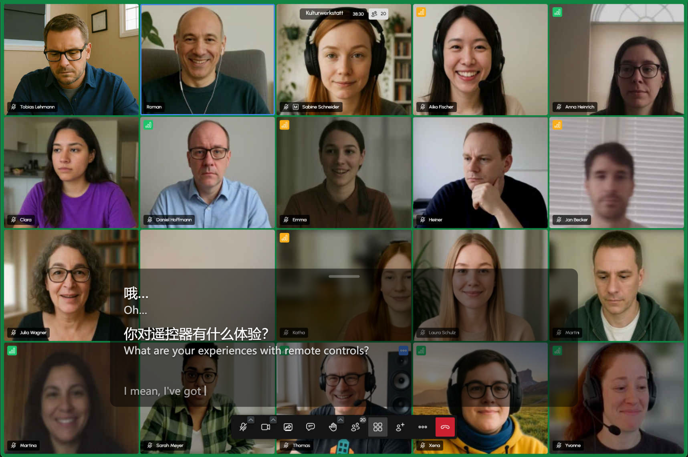
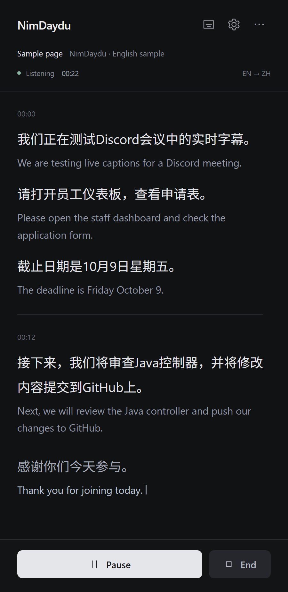
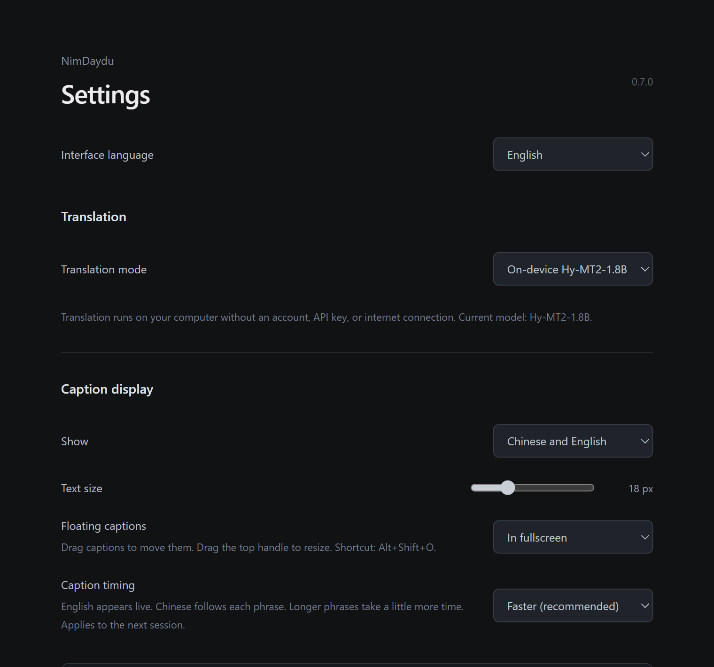
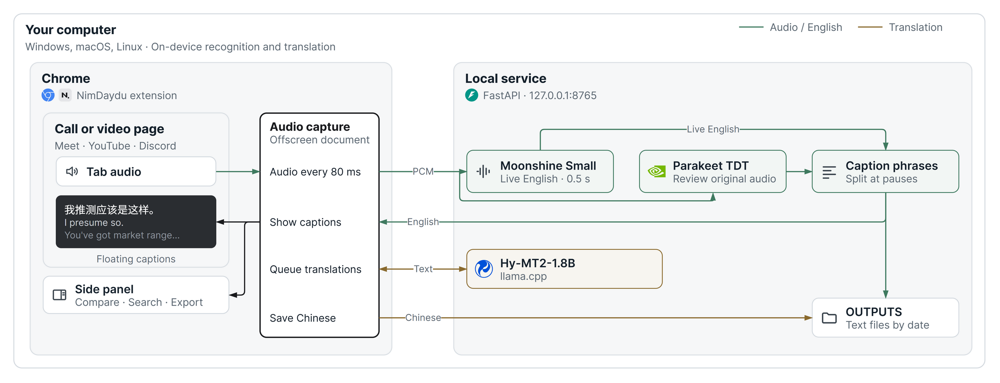
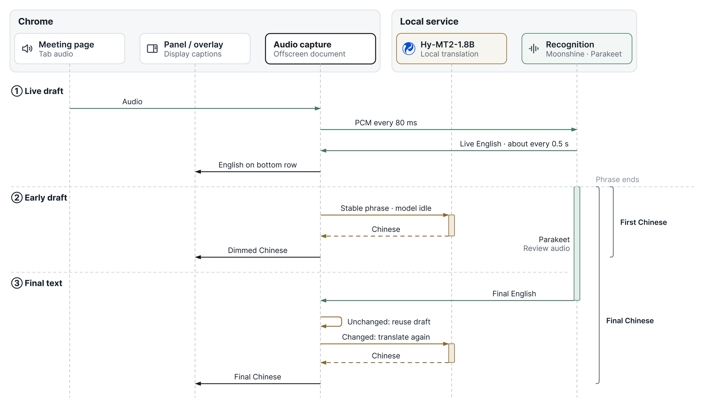

<h1 align="center">NimDaydu</h1>

<p align="center"></p>

<p align="center"><a href="README.md">English</a> | <a href="README.zh-CN.md">简体中文</a></p>

NimDaydu turns English audio in Chrome into live English and Simplified Chinese captions. Recognition and translation run on your computer and are free to use.

<p align="center">
  <br>
  <sub>Jitsi Meet screenshot by Sphere231 (CC0). Captions from a public AMI recording. <a href="https://commons.wikimedia.org/wiki/File:Jitsi_Meet_gallery_view.jpg">Image source</a></sub>
</p>

## What you can do

- **Follow spoken English live.** English appears as people speak. Chinese follows phrase by phrase, with lighter text for early translations. A second speech model checks the original audio before finalizing the English.
- **Read on the page or in the side panel.** Floating captions appear automatically in fullscreen. Drag to move them, use the top handle to resize, or scroll back to an earlier line.
- **Find and correct what was said.** Search the transcript and correct technical terms in one line, across the session, or for future sessions. Corrected lines are translated again.
- **Keep a local transcript.** Final captions are saved as text, with TXT, JSON, SRT, and Markdown export. Reopen saved sessions, or import recordings and click a timestamp to listen back.

<table><tr>
<td width="44%" valign="top"></td>
<td valign="top"></td>
</tr></table>

## Quick start

Use Chrome 142 or later and allow about 4 GB of free disk space. 16 GB of RAM is recommended. Download the repository with **Code → Download ZIP** and extract it, or clone it with Git.

After the initial model download, NimDaydu works offline without an account or API key.

| System | Install from the project folder | Start the local service |
|---|---|---|
| Windows 10 or 11, 64-bit | Install uv and Node.js LTS, then run the setup script below. | Double-click the green **NimDaydu 启动.exe** on your desktop, or open `Start-NimDaydu.cmd` from the project folder. |
| macOS 15 or later, Apple silicon | `bash setup.sh` | Double-click `Start-NimDaydu.command` in Finder, or run `bash start.sh`. |
| Ubuntu 24.04, x86-64 | `bash setup.sh` in a folder on the Linux filesystem | `bash start.sh` |

On Windows, reopen PowerShell in the extracted project folder after installing uv and Node.js.

```powershell
winget install --id astral-sh.uv -e
winget install --id OpenJS.NodeJS.LTS -e
```

```powershell
powershell -NoProfile -ExecutionPolicy Bypass -File .\setup.ps1
```

1. In `chrome://extensions`, turn on **Developer mode**, click **Load unpacked**, and select the project's `extension/.output/chrome-mv3` folder. Pin NimDaydu from the extensions menu.
2. Start the local service. On a regular web page, open the NimDaydu side panel and click **Play English sample**.
3. In the sample tab, click the NimDaydu toolbar icon, click **Start**, then play the audio. English appears as the sample plays, followed by Chinese.
4. Click **End** to finish. To free model memory, use the red **NimDaydu 关闭.exe** or `Stop-NimDaydu.cmd` on Windows, `Stop-NimDaydu.command` on macOS, or `bash stop.sh` on macOS and Ubuntu.

## Use NimDaydu

- **Web audio.** Click the NimDaydu icon in the tab playing audio, then click **Start**. Try Discord in Chrome, YouTube, or a web meeting. **Alt + Shift + N** opens the side panel and **Alt + Shift + O** toggles floating captions. On macOS, use **Option** in place of **Alt**.
- **Desktop audio.** Choose **More → Transcribe desktop audio** and share a source with audio in Chrome's picker. Use **More → History and file transcription** to open an always-on-top caption window. Audio sharing options depend on your system and Chrome.
- **Recordings.** In **History and file transcription**, choose a local audio or video file and click **Transcribe file**. File transcription requires `ffmpeg` on your PATH.
- **Language and display.** Choose English or 简体中文 in **Settings → Interface language**. NimDaydu remembers your choice. **Caption display** controls what you read. Turn translation off for English-only transcription.

By default, each session is saved in `OUTPUTS` as `transcript.txt` and `session.json`. You can turn off automatic saving in Settings. Live audio is processed in memory. Only finalized captions are saved. Check the English before relying on a translated name, number, or technical term.

## How it works



Moonshine streams English as you listen. Parakeet reviews the audio on the CPU, and Hy-MT2 translates stable phrases into Chinese using llama.cpp. Translation uses Vulkan on Windows and Metal on macOS when available, and can also run on the CPU. The extension and local service communicate over `127.0.0.1`.



## Why NimDaydu

NimDaydu started with English Discord calls. I wanted to keep up with the original speech, glance at Chinese when I missed something, and find the exact line again after the call. Chrome's built-in live captions transcribe locally, and its Live Translate feature sends captions to Google. Live Subtitle also offers on-device translation for browser audio. NimDaydu puts reviewed English, its Chinese translation, and a searchable transcript on your own computer. [Chrome captions](https://support.google.com/chrome/answer/10538231?hl=en) · [Live Subtitle](https://github.com/xu-0306/live-subtitle)

## License

[MIT](LICENSE) · [Third-party notices](THIRD_PARTY_NOTICES.md)
