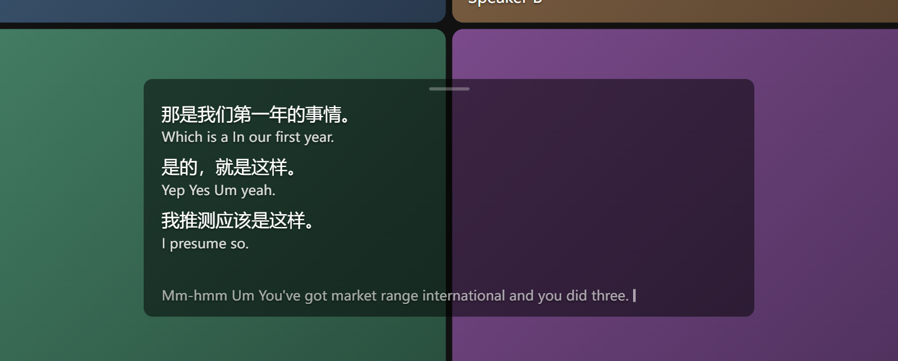
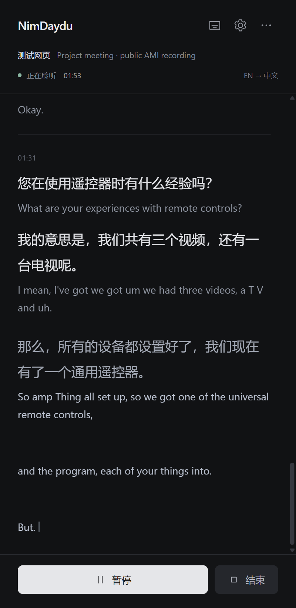
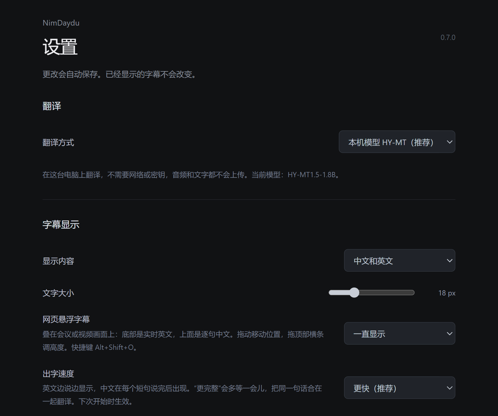
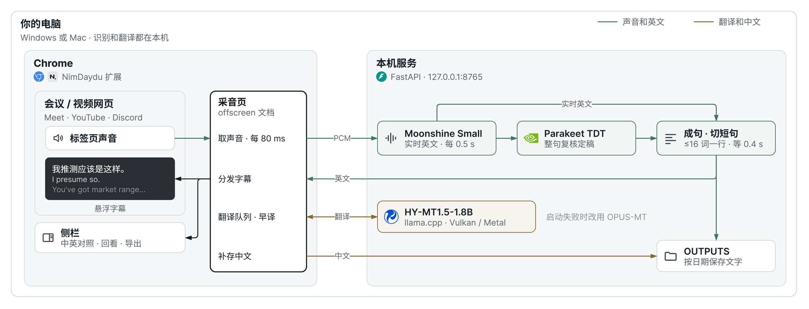
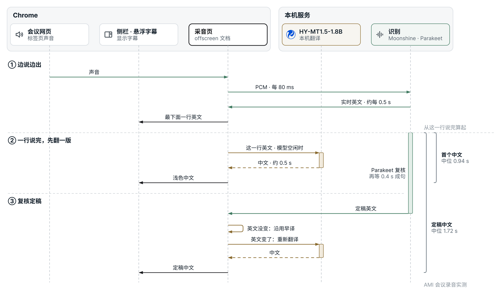

# NimDaydu

NimDaydu 是一个 Chrome 扩展，把网页里的英文语音实时转成英文字幕，并翻译成中文。识别和翻译都在你自己的电脑上完成：不上传音频，不需要注册账号，也没有使用费。

适用于在 Chrome 里能播放声音的网页，例如 Discord 网页版、YouTube、Google Meet，以及 Zoom、Teams、Slack 的网页版。

## 功能

- **侧栏字幕**：中英对照，每个英文短句下面紧跟着它的中文。可以回看、搜索，也可以导出 TXT 或 JSON。
- **网页悬浮字幕**：半透明的字幕框叠在网页上，网页全屏时会自动出现。底部一行是边说边出的英文，上面是已经说完的句子；每句的中文译好后，会填到这句英文的上方。
- **中文跟得上**：一句话刚说完，本机模型就先把它翻成中文（浅色显示）；整句复核定稿后，文字一致时直接沿用，不一致才重新翻译。
- **自动保存**：每次字幕自动保存到项目里的 `OUTPUTS` 文件夹，只保存文字，不保存音频。
- **完全本机运行**：英文识别使用 Moonshine 和 Parakeet，中文翻译使用腾讯 HY-MT1.5，三个模型都运行在你的电脑上。

<table><tr>
<td width="44%" valign="top"></td>
<td valign="top"></td>
</tr><tr>
<td align="center">侧栏：浅色中文是刚说完就先翻的，定稿后变为正常颜色</td>
<td align="center">设置页</td>
</tr></table>

截图使用 AMI 会议语料库的公开录音（CC BY 4.0），背景是测试页面。

## 系统要求

| | Windows | Mac |
|---|---|---|
| 系统 | Windows 10 或 11（64 位） | Apple 芯片（M1 及以后），macOS 15 或更新版本 |
| 内存 | 推荐 16 GB | 推荐 16 GB |
| 磁盘空间 | 约 4 GB | 约 4 GB |
| 浏览器 | Chrome 142 或更新版本 | Chrome 142 或更新版本 |

识别在 CPU 上运行。翻译优先使用显卡：Windows 上通过 Vulkan，支持 Intel、AMD、NVIDIA 显卡；Mac 上通过 Metal。没有可用显卡时，翻译自动改用 CPU。

## 安装

两个系统的安装步骤不同：

- **Windows**：见 [docs/windows.md](docs/windows.md)
- **Mac**：见 [docs/mac.md](docs/mac.md)

安装只需要做一次。安装脚本会把依赖和模型都放在项目文件夹里，不影响电脑上的其他软件。

## 日常使用

1. **启动本机服务**：Windows 双击 `Start-NimDaydu.cmd`，Mac 双击 `Start-NimDaydu.command`。看到“已就绪”就可以了。
2. **打开字幕**：在有英文声音的网页上，点击浏览器工具栏里的 NimDaydu 图标打开侧栏，然后点 **开始**。也可以用快捷键打开侧栏：Windows 是 Alt + Shift + N，Mac 是 Option + Shift + N。
3. **悬浮字幕**：网页全屏时会自动出现。随时显示或隐藏它：点侧栏顶部的字幕按钮，或按 Alt + Shift + O（Mac 是 Option + Shift + O）。想让它在普通窗口里也一直显示，在设置里把“网页悬浮字幕”改成“一直显示”。
   - 拖动字幕框可以移动位置，双击回到底部；拖动顶部的小横条可以调高度。默认大约显示 3 句，加上底部一行实时英文。
   - 鼠标移上去会出现 A− / A+ 调整字号，× 暂时隐藏。
   - 用滚轮往上翻可以回看前面的句子，翻回最底部后会继续自动滚动。
   - 一段时间没人说话时，背景会变得更透明，但字幕框不会消失。
   - 设置为“只看中文”时，悬浮字幕也只显示已经译好的中文。
4. **结束**：在侧栏点 **结束**，等最后一句中文出来。不用时再运行停止脚本释放内存：Windows 双击 `Stop-NimDaydu.cmd`，Mac 双击 `Stop-NimDaydu.command`。

只要侧栏或悬浮字幕有一个开着，字幕就会继续。两个都关闭约 10 秒后，采集会自动停止。

## 工作原理

NimDaydu 由两部分组成：Chrome 扩展负责采集标签页的声音和显示字幕，本机服务负责识别和翻译。两者只通过 `127.0.0.1` 通信。

- **采音页**是扩展在后台打开的一个隐藏页面。它取声音、排队翻译，再把字幕发给侧栏和悬浮字幕，所以关掉侧栏后悬浮字幕仍然能继续。
- **Moonshine Small** 边听边出英文，大约每 0.5 秒更新一次。
- **Parakeet TDT** 在一行说完后，把这段声音再识别一遍，得到更准确的定稿。
- **HY-MT1.5-1.8B** 负责翻译。它通过 llama.cpp 运行，Windows 上用 Vulkan、Mac 上用 Metal 调用显卡。

## 字幕是怎么出现的

- 英文边说边显示在侧栏和悬浮字幕的最下面，听到更多内容后可能会修正。说的过程中就已经按句子分好行，句子定稿后会留在原来的位置。
- 一个短句说完后，NimDaydu 会用更准确的模型把这段音频重新识别一遍，确定英文，然后翻译成中文。
- 长句会在逗号或连词处切成几个短句，每个短句各自翻译，中文出现得更早，也更容易跟读。
- 使用本机模型时，刚说完的一句会先被翻成中文，以浅色显示在实时英文上方，多数时候在这句话说完后一秒左右出现。整句复核定稿后，如果英文没变，就直接沿用这句中文；变了才重新翻译。
- 定稿的中文译好之前，这句英文上方会显示“…”占位，译好后直接填进去，下面的内容不会被挤动。定稿后的中文不会再变。翻译偶尔失败时会自动重试；仍然失败时，侧栏会出现“恢复翻译”按钮。

多人同时说话、口音重或背景噪声大时，英文可能识别错，中文也会跟着错，而且错得很通顺。重要内容请对照英文。

## 设置

点侧栏右上角的齿轮打开设置页。更改会自动保存。

| 项目 | 默认 | 说明 |
|---|---|---|
| 翻译方式 | 本机模型 HY-MT | 也可以选 Chrome 内置翻译、DeepSeek（联网，需要自己的 API 密钥），或者不翻译 |
| 显示内容 | 中文和英文 | 也可以只看中文或只看英文 |
| 文字大小 | 18 px | 同时影响侧栏和悬浮字幕 |
| 网页悬浮字幕 | 全屏时自动显示 | 也可以设为一直显示或关闭 |
| 出字速度 | 更快 | “更完整”会多等一会儿，把同一句话合在一起翻译 |
| 识别方式 | 实时 + 整句复核 | 想省电可以只用实时识别，但准确度会下降 |
| 自动保存 | 开启 | 保存位置是项目里的 `OUTPUTS` 文件夹 |

关于 Chrome 内置翻译：它只能在侧栏打开时工作，网页全屏或关闭侧栏后中文会暂停。本机模型和 DeepSeek 没有这个限制。

`glossary.json` 用来固定品牌名称的写法，例如 `discord → Discord`，避免被译成“不和”。修改后重启本机服务即可生效。

## 保存与导出

- 自动保存的字幕按日期存放，例如 `OUTPUTS/2026-10-28/20261028-214651_youtube_<会话ID>/`。
- 每个文件夹里有两个文件：`transcript.txt` 方便阅读，`session.json` 包含时间、英文和中文。
- 侧栏右上角 **更多** 菜单里可以搜索字幕、导出 TXT / JSON、清空侧栏。清空侧栏不会删除已经保存的文件。
- 只保存定稿的文字，不保存音频和实时草稿。如果电脑突然断电，最后几秒可能来不及保存。

## 隐私

- 音频只在你的电脑上处理，不会上传，也不会写入硬盘。
- 本机服务只接受 `127.0.0.1` 的连接，并且只把连接令牌交给已安装的 NimDaydu 扩展。
- 只有选择 DeepSeek 翻译时，英文文字才会发送到 DeepSeek，音频始终不会发送。
- NimDaydu 只采集你点击“开始”的那个标签页，不使用麦克风，不读取网页里的消息和账号。
- 在会议中使用时，请按照所在场合的要求告知其他参与者。

## 限制

- 只能采集 Chrome 标签页的声音。Windows 和 Mac 上的桌面版 Discord、Zoom 等客户端不支持，请改用网页版。
- 只支持把英文翻译成中文。
- 不区分说话人。
- 部分受版权保护的媒体，或者公司管理的浏览器，可能不允许采集声音。

## 常见问题

| 情况 | 处理 |
|---|---|
| 侧栏显示“本机服务未连接” | 先运行启动脚本（Windows：`Start-NimDaydu.cmd`，Mac：`Start-NimDaydu.command`），然后在侧栏点“重新连接” |
| “开始”按钮是灰的 | 在有声音的网页上点一次工具栏里的 NimDaydu 图标 |
| 全屏后看不到悬浮字幕 | 确认设置里的“网页悬浮字幕”不是“关闭”，或者按 Alt + Shift + O |
| 快捷键没反应 | 打开 `chrome://extensions/shortcuts` 查看或修改快捷键 |
| 网页刷新后悬浮字幕不见了 | 在这个网页上按 Alt + Shift + O（Mac 是 Option + Shift + O） |
| 设置页显示翻译模型是 OPUS-MT | HY-MT 没有启动成功，正在用质量较低的备用模型。重新运行一次安装脚本 |
| 提示“正在追赶” | 电脑暂时忙不过来。音频不会丢，通常几秒后自动恢复 |
| 提示“语音识别持续积压” | 关闭其他占用 CPU 很多的程序，然后重新开始 |

## 更多文档

- [Windows 安装与使用](docs/windows.md)
- [Mac 安装与使用](docs/mac.md)
- [第三方组件与许可](THIRD_PARTY_NOTICES.md)。翻译模型 HY-MT1.5 使用腾讯的社区许可，不适用于欧盟、英国和韩国。
- 开发记录：[方案与决策](docs/dev/plan.md)、[测试记录](docs/dev/benchmarks.md)、[开发说明](docs/dev/development.md)
