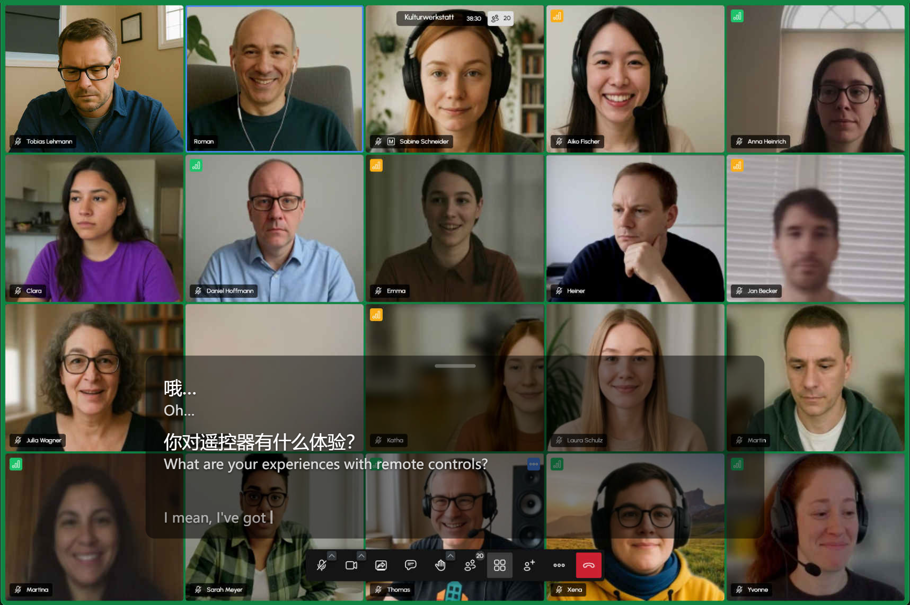
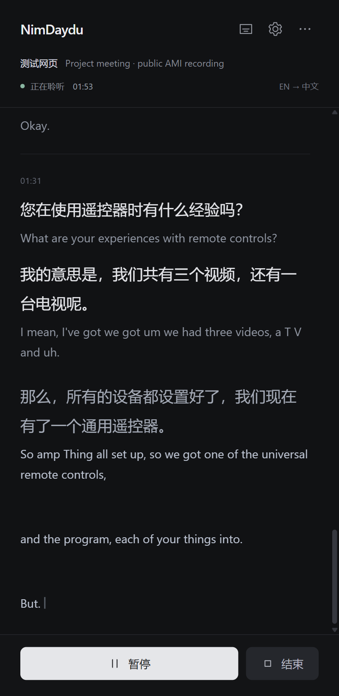
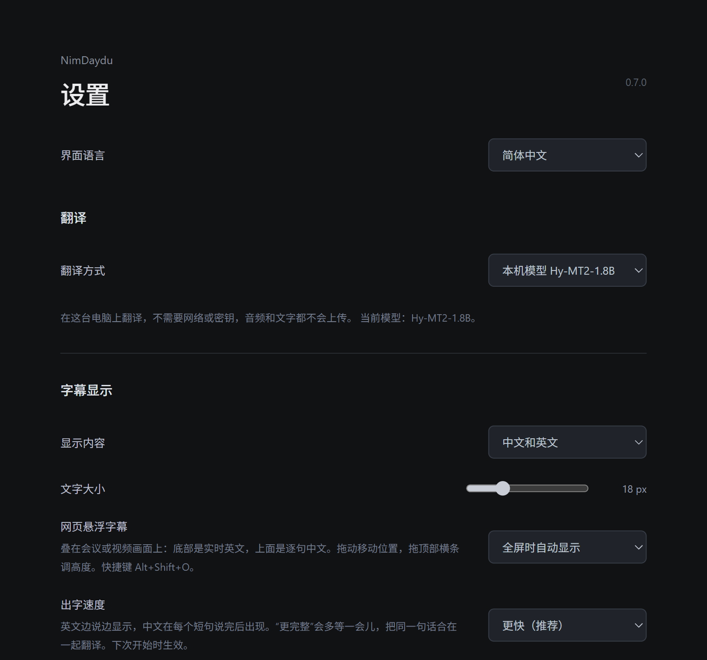
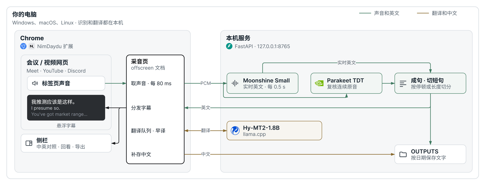
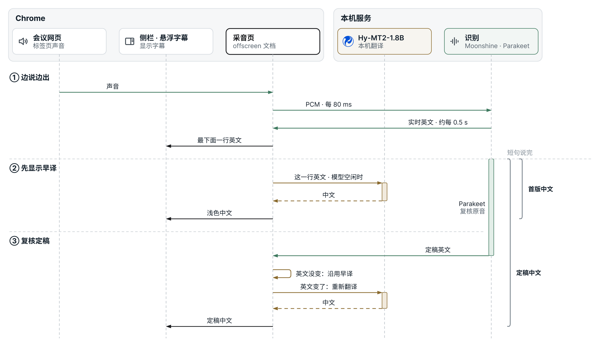

<h1 align="center">NimDaydu</h1>

<a href="README.md">English</a> | <a href="README.zh-CN.md">简体中文</a>

NimDaydu 把 Chrome 里播放的英文语音实时转成中英双语字幕。识别和翻译都在自己的电脑上运行，免费使用。

   
  Jitsi Meet 会议截图由 Sphere231 公开发布（CC0）。字幕来自 AMI 公开会议录音。<a href="https://commons.wikimedia.org/wiki/File:Jitsi_Meet_gallery_view.jpg">原图与许可</a>

## 能做什么

- **边听边看。** 英文边说边出，中文逐句跟上，浅色中文是提前显示的译文。第二个识别模型会复核原音，再定稿英文。
- **侧栏和网页悬浮字幕。** 网页全屏时会自动弹出字幕。可以拖动位置、拉顶部横条调高度，或者往上滚动回看。
- **回找原话和纠正术语。** 可以搜索字幕，纠正本句、整场或以后遇到的同一术语。改过的句子会重新翻译。
- **保留本机文字记录。** 自动保存定稿字幕，支持 TXT、JSON、SRT 和 Markdown 导出。也可以打开以前的会话，导入音视频文件转录，点击时间回听。

<table><tr>
<td width="44%" valign="top"></td>
<td valign="top"></td>
</tr></table>

## 快速开始

需要 Chrome 142 或更新版本，约 4 GB 可用磁盘空间，推荐 16 GB 内存。在 GitHub 点 **Code → Download ZIP** 后解压，或者用 Git 克隆。

首次下载模型后可离线使用，无需账号或 API 密钥。

| 系统 | 在项目目录安装 | 启动本机服务 |
|---|---|---|
| Windows 10 或 11，64 位 | 按 [Windows 安装指南](docs/windows.md) 安装 uv 和 Node.js LTS，再运行 `setup.ps1`。 | 双击桌面绿色的 **NimDaydu 启动.exe**，也可双击项目里的 `Start-NimDaydu.cmd`。 |
| macOS 15 或更新版本，Apple 芯片 | 运行 `bash setup.sh`。详见 [Mac 安装指南](docs/mac.md)。 | 在访达双击 `Start-NimDaydu.command`，或运行 `bash start.sh`。 |
| Ubuntu 24.04，x86-64 | 在 Linux 文件系统里的项目目录运行 `bash setup.sh`。 | 运行 `bash start.sh`。 |

1. 打开 `chrome://extensions`，开启**开发者模式**，点**加载未打包的扩展程序**，选择项目里的 `extension/.output/chrome-mv3`。从扩展菜单把 NimDaydu 固定到工具栏。
2. 启动本机服务，在任意普通网页打开 NimDaydu 侧栏，点**试听英语样本**。
3. 在样本标签页点击工具栏里的 NimDaydu 图标，点**开始**，再播放音频。先看到实时英文，随后显示中文。
4. 点**结束**收尾。用完后可释放模型内存。Windows 双击红色的 **NimDaydu 关闭.exe** 或项目里的 `Stop-NimDaydu.cmd`，Mac 双击 `Stop-NimDaydu.command`，Mac 和 Ubuntu 也可以运行 `bash stop.sh`。

## 日常使用

- **网页声音。** 在播放声音的标签页点击 NimDaydu 图标，再点**开始**。可以用于 Discord 网页通话、YouTube 或网页会议。用 **Alt + Shift + N** 打开侧栏，**Alt + Shift + O** 显示或隐藏悬浮字幕。Mac 上把 **Alt** 换成 **Option**。
- **桌面声音。** 点**更多 → 转录桌面声音**，在 Chrome 选择器里共享带声音的来源。打开**更多 → 历史记录与文件转录**后，也可以开启实时置顶字幕窗。能否共享音频取决于系统和 Chrome。
- **录音和视频。** 在**历史记录与文件转录**里选择本地文件，再点**转录文件**。导入音视频需要能在终端里运行 `ffmpeg`。
- **语言和显示。** 打开**设置 → 界面语言**选择 English 或简体中文，选择会自动记住。**字幕显示**独立控制中英双语、只看中文或只看英文，也可以关闭翻译。

每场字幕默认保存到 `OUTPUTS` 下的 `transcript.txt` 和 `session.json`，可在设置里关闭自动保存。实时音频只在内存里处理，磁盘上只保存定稿字幕。重要人名、数字或术语建议对照英文。

## 工作原理

Moonshine 先实时显示英文，Parakeet 在 CPU 上复核原音，Hy-MT2 通过 llama.cpp 把稳定的短句翻译成中文。翻译在 Windows 上优先用 Vulkan，在 Mac 上优先用 Metal，也可以用 CPU。扩展和本机服务通过 `127.0.0.1` 通信。

## 为什么做

起初是为了听 Discord 里的英文通话。我想跟上原话，没听清时瞄一眼中文，结束后还能搜回具体哪一句。Chrome 自带字幕能本机转录，开启实时翻译时会把字幕发给 Google。Live Subtitle 也能在本机翻译浏览器音频。NimDaydu 把经过复核的英文、对应的中文和可搜索的字幕记录放在同一台电脑上。 [Chrome 字幕说明](https://support.google.com/chrome/answer/10538231?hl=zh-Hans) · [Live Subtitle](https://github.com/xu-0306/live-subtitle)

## 许可证

[MIT](LICENSE) · [第三方组件与许可](THIRD_PARTY_NOTICES.md)
